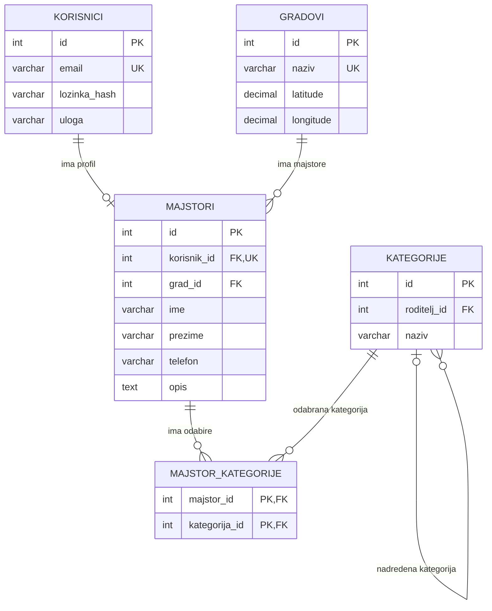

# Majstori Web App – Entity Relationship Diagram

Majstori Web App je single-page aplikacija za pronalaženje majstora i pregled njihovih usluga. Administrator upravlja korisničkim računima i hijerarhijskim stablom kategorija majstorluka. Majstori uređuju profile i biraju jednu ili više kategorija koje odgovaraju njihovim specijalizacijama. Posjetioci pretražuju majstore prema kategorijama i, opcionalno, prema gradu i radijusu udaljenosti.

Model u nastavku predstavlja početni prijedlog nakon inicijalne analize zahtjeva i može se mijenjati tokom daljeg rada na projektu.

## Relationships

| Relationship | Type | Rule |
|---|---|---|
| Korisnik → Profil majstora | 1:0..1 | Korisnički račun može imati najviše jedan profil majstora. Svaki profil pripada tačno jednom korisniku. Administratorski račun ne mora imati profil majstora. |
| Grad → Profili majstora | 1:N | Svaki profil mora imati jedan odabrani grad; jedan grad može biti povezan s više profila. |
| Profil majstora → Odabiri kategorija | 1:N | Majstor može direktno odabrati proizvoljan broj kategorija, uključujući kategorije iz različitih grana stabla. |
| Kategorija → Odabiri majstora | 1:N | Istu kategoriju može direktno odabrati više majstora. |
| Kategorija → Podkategorije | 1:N | Kategorija može imati više podkategorija, a podkategorija može imati najviše jednu neposredno nadređenu kategoriju. Glavna kategorija nema roditelja. |

`MAJSTORI` i `KATEGORIJE` imaju odnos više-prema-više (M:N), riješen veznom tabelom `MAJSTOR_KATEGORIJE`. Sastavljeni primarni ključ (`majstor_id`, `kategorija_id`) sprečava dupliranje istog odabira za jednog majstora.

## Pravila odabira kategorija i pretrage

- Administrator održava stablo kategorija: dodaje, preimenuje i premješta kategorije, uz provjeru da premještanjem ne nastane ciklus.
- Majstor sam bira jednu ili više kategorija iz stabla. Odabir roditeljske kategorije ne znači da je automatski odabrao njene podkategorije.
- Kada posjetilac pretražuje kategoriju X, prikazuju se majstori koji su direktno odabrali X ili barem jednu kategoriju koja se nalazi ispod X u stablu.
- Pretraga ne obuhvata majstore koji su odabrali samo roditeljsku kategoriju kategorije X, niti one koji su odabrali kategoriju iz druge grane.
- Pravilo važi bez obzira na dubinu stabla i na naknadno dodavanje novih kategorija.

## Ostale napomene o modelu

- Uloge u početnoj verziji su `admin` i `majstor`. E-mail je jedinstven, a lozinka se čuva kao hash.
- Gradovi se čuvaju s koordinatama; majstor bira grad iz kontrolisane liste. Lokacijska pretraga koristi približnu vazdušnu udaljenost između gradova, ne cestovnu udaljenost niti tačnu adresu.
- U početnoj verziji nema javne registracije majstora; račune kreira administrator.
- Model trenutno ima pet tabela: `KORISNICI`, `GRADOVI`, `MAJSTORI`, `KATEGORIJE` i `MAJSTOR_KATEGORIJE`. Konačni SQL i ograničenja stranih ključeva razradit će se tokom implementacije.
